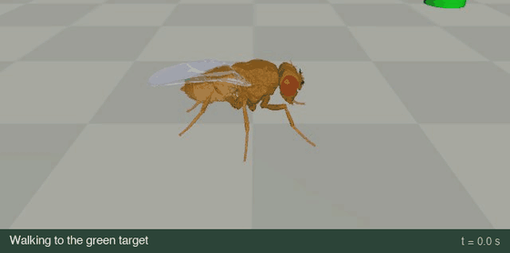
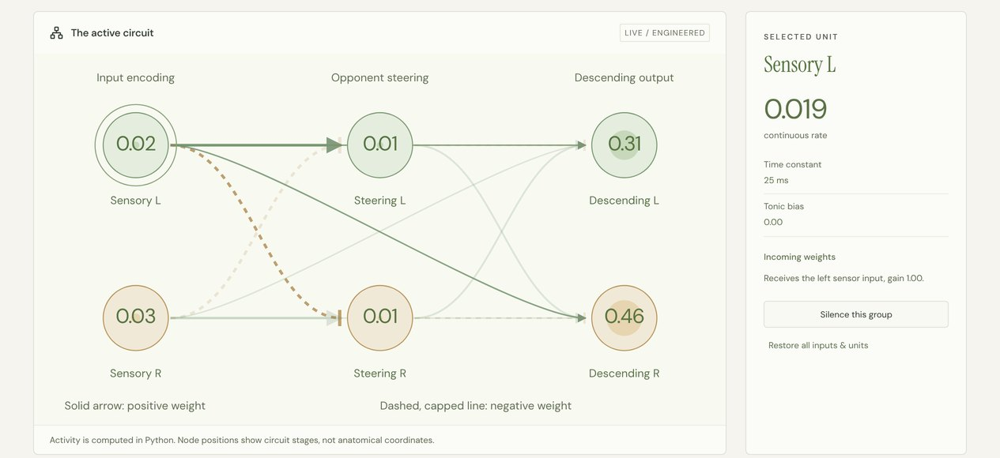
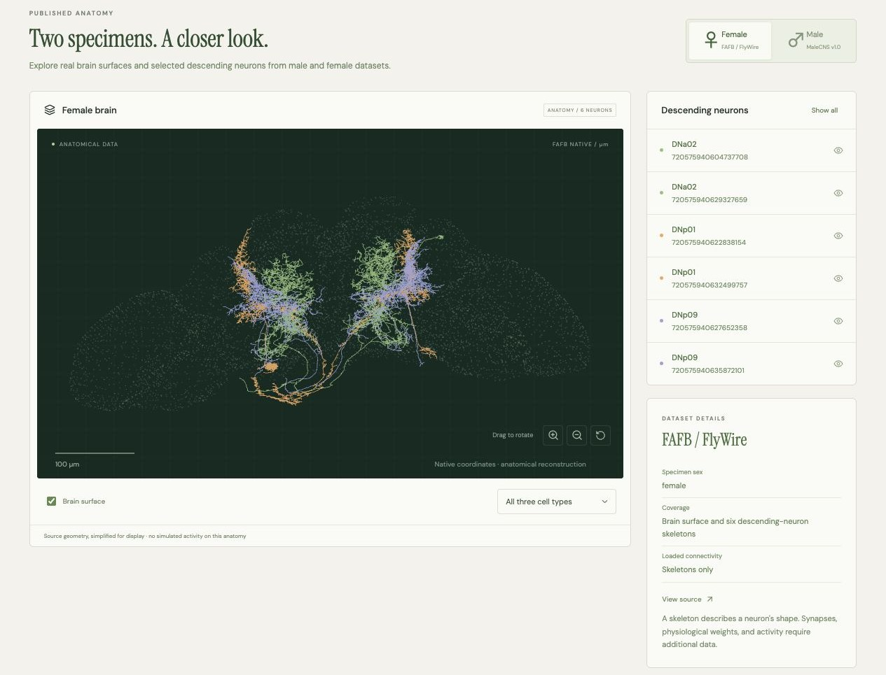

<h1 align="center">DigitalFly</h1>

<p align="center"><b>A virtual fruit fly you can poke.</b><br>
A physics-simulated fly walks toward what it sees, steered by a brain you can inspect, silence and tune:<br>six hand-built units, or circuits wired from the FlyWire connectome, with rate or spiking neurons.<br>
Build your own circuit around any cell type, manipulate any cell type on either side, run batch experiments,<br>test which modelling assumptions a result depends on, and compare with recorded flies.<br>
Everything runs on your own computer, in your browser.</p>

<p align="center"></p>

> **Why is the repo called frankenfly?** Because this fly is stitched together from parts: a female fly's physics body ([NeuroMechFly](https://neuromechfly.org/)), brain scans of two *different* flies (one female, one male), and a choice of brains. The default is six hand-built "rate units". The others are patches of the female fly's connectome ([FlyWire](https://flywire.ai/) v783): 3,000 neurons around the DNa02 steering neurons, a 4,000-neuron circuit around three descending neuron types (DNa01, DNa02 and DNp09), side-balanced versions of both, or any circuit you build, up to the whole brain. The body and physics are real. In the connectome brains, who connects to whom, and how strongly, is real data, but each connection's sign is assumed from its predicted transmitter, and the wiring to the eyes and legs is engineered. They are not an uploaded fly brain and not biologically validated. The DNa02 circuit circles the target instead of reaching it (its side-balanced version circles closer, and reaches a few targets on the way); the three-type circuit reaches it, because one of its readouts, DNp09, turns toward it.

## What you can do

- **Run the closed loop.** Move the green target and watch the fly turn and walk toward it. Neural activity, leg contacts and walking rhythm update live, and you can look through the fly's own compound eyes (721 facets per eye).
- **Swap the brain.** Drive the body with the engineered six-unit controller or a connectome circuit, with rate units or the spiking neurons of Shiu et al. 2024, and inspect it cell type by cell type while it runs, including the strongest pathways into its steering neurons.
- **Build your own circuit.** Pick any FlyWire cell types or neurons as seeds, choose hops, synapse threshold and size (or the whole brain), optionally keep each cell type's left and right neurons in balance, and run the result: in the app or from the command line.
- **Explore the whole brain's wiring.** For any FlyWire v783 cell type or neuron, list its upstream and downstream partners, find the strongest or shortest paths to another, and score its steady-state influence across all 144,837 neurons (a BANC-style linear approximation), in seconds on a laptop. Every result row silences or activates its cell type in the running circuit, or starts a circuit build around it, in one click, and any selection, path or circuit opens in Neuroglancer, streaming the neurons from FlyWire's public data.
- **Intervene.** Silence the left or right sensor or a group of units, or silence, scale or activate any cell type of the circuit on the left, the right or both sides, live or on a schedule, and see how behavior changes. Every manipulation is labeled engineered: activation approximates optogenetic activation and is not calibrated.
- **Shape the motor path.** Weight and pool the readout neurons, and add a delay and a low-pass between the descending neurons and the legs, with a warning when the motor command saturates.
- **Run experiments.** Start from a one-click first experiment or a saved preset, script timed stimulus changes, compare conditions (including the two brains and labeled conditions of your own) across matched random seeds, and read each comparison's means, intervals and paired differences. Keep every trial in a run library you can filter, tag and annotate; export runs as CSV, JSON and ZIP (share-safe if you publish them), and replay them exactly, or have the app verify the replay in the background.
- **Test your assumptions.** Rerun an analysis over sign rules, synapse thresholds, readout pooling and weights, dynamics, seeds and side-balanced circuits, and see which conclusions survive every variant.
- **See through FlyVis eyes (optional).** Run the rendered eye images through FlyVis, a connectome-constrained model of the fly's optic lobe, and let its cell types drive the circuit's visual neurons through FlyWire wiring.
- **Compare with a real fly.** Import a published recording of both DNa02 neurons in a walking fly and fit how its turning follows them, side by side with the model, leaving out the epochs when the fly was stimulated.
- **Score a model against published experiments.** A validation scorecard activates or silences the cell types that published experiments did (DNa02, DNp09, MDN and others), measures the fly's behavior and gives pass, partial or fail by rules fixed in advance, with each source cited; tests the model or the body cannot express yet are listed as not testable or blocked.
- **Analyze at scale.** A research toolkit (Python and command line) runs batches of trials and parameter sweeps in parallel, survives failed trials and resumes interrupted ones, reports intervals, measures a circuit's left/right bias, manipulates every cell type in turn to find what drives it, traces pathways, and fits turning against readout activity in runs or recorded flies. A small Python client drives the running app from scripts and notebooks ([examples](examples/README.md)).
- **Explore real anatomy.** Rotate male and female fly brains with twelve published neuron reconstructions, or import your own small wiring diagram to inspect.


**The default brain:** six engineered units, live, with every weight visible and editable. The connectome brain has its own live view, by cell type, in the same **Live circuit** tab.



**Real anatomy** from published connectomes. With the connectome brain running, the female DNa02 skeletons glow with its computed activity, labeled as model output.



## Quick start

You need **Python 3.12** (3.13 and 3.14 also run the app, without FlyVis), **Node.js 22.12 or newer** (up to 26) with npm, and OpenGL for the 3D views. v0.6 was validated on x86-64 Linux, with the physics under a virtual display (Xvfb and GLFW) and in the Docker image with headless EGL; the optional FlyVis install was last validated at v0.5. Apple-silicon macOS was last validated at v0.2; later versions have not been run there. See [STATUS](STATUS.md#validation-summary).

```sh
git clone https://github.com/Jeevash23/frankenfly.git
cd frankenfly
./scripts/setup.sh
./scripts/start.sh --open
```

Setup builds a local Python environment and installs pinned, hash-checked dependencies, which takes a few minutes the first time; `python3 scripts/doctor.py` checks the result and names a fix for anything missing. The app opens paused at http://127.0.0.1:8000. Add `--vision` to start with rendered compound-eye input, read by an engineered green-object detector; FlyVis eyes are a separate, optional sensor you pick in the app (see [FlyVis eyes](docs/USAGE.md#flyvis-eyes)). To stop it, click **Quit** in the app or press Ctrl+C in the terminal.

**No Python 3.12?** If [uv](https://docs.astral.sh/uv/) is installed, setup uses a uv-managed Python 3.12, installing one first if needed (about 30 MB). Otherwise install Python 3.12 from [python.org](https://www.python.org/downloads/) or with Homebrew (`brew install python@3.12`), or use a Python 3.13 or 3.14 you already have, and point setup at it:

```sh
PYTHON_BIN=/path/to/python3.12 ./scripts/setup.sh
```

Python 3.12 is the recorded stack: on 3.13 and 3.14 the app, the toolkit and the tests work, but FlyVis does not install, and runs recorded on 3.12 are not guaranteed to replay exactly.

**Or with Docker**, which needs neither Python nor Node.js on your computer and renders without a display:

```sh
docker compose up --build     # then open http://localhost:8000
```

[INSTALL](docs/INSTALL.md) covers every route: native installs and setup options (`--backend-only`, `--with builder,flyvis,recording`, `--check`), updating after `git pull`, Docker, the dev container, headless servers and Windows through WSL2 (untested).

## How it works

```text
target ─► sensors: target bearing, or rendered compound-eye pixels
       ─► neural model, either
            six leaky rate units: sensory ─► steering ─► descending, or
            a FlyWire circuit (rate or spiking): visual projection neurons ─► … ─► readout neurons left/right
       ─► left/right descending command
       ─► FlyGym walking controller: joint and adhesion targets
       ─► MuJoCo physics ─► new body pose ─► back to the sensors
```

All simulation runs in Python; the browser only displays it. Physics advances every 0.1 ms, the neurons every 1 ms, and the descending command every 10 ms. A run is deterministic for its seed, so saved experiments replay exactly on the same software stack.

## Documentation

- [Installation](docs/INSTALL.md): native installs, setup options, updating, Docker, the dev container and headless servers
- [Usage guide](docs/USAGE.md): controls, presets, saved runs, replay, scripting the app and troubleshooting
- [Research guide](docs/RESEARCH.md): a first experiment, signal definitions, data sources, analyses and limits
- [Architecture](docs/ARCHITECTURE.md): the closed loop, equations, timing and safety boundaries
- [Dependencies](docs/DEPENDENCIES.md): pinned versions, CI and how to reproduce validation
- [Status](STATUS.md): what's implemented and how it was validated
- [Changelog](CHANGELOG.md): what changed in each version
- [Examples](examples/README.md): scripts that drive the app and run batches from Python
- [Contributing](CONTRIBUTING.md), [security](SECURITY.md) and [how to cite](CITATION.cff)

## Development

```sh
./scripts/dev.sh                   # hot-reloading UI at http://127.0.0.1:5173
./scripts/check.sh                 # every backend test (including real physics), frontend format check, unit tests and build
./scripts/check.sh --fast          # the same without the FlyGym physics tests
npm --prefix frontend run format   # format the frontend with Prettier
npm --prefix frontend run e2e      # browser end-to-end tests of the built app (toy engine, headless Chromium)
```

The physics tests need an OpenGL context; on Linux without a display or a working EGL, `check.sh` runs them under `xvfb-run` when it is installed ([details](CONTRIBUTING.md#running-the-tests)). The end-to-end tests need Playwright's Chromium once (`cd frontend && npx playwright install chromium`) and a current build (`npm --prefix frontend run build`). After changing the API's models, regenerate the frontend's types with `backend/.venv/bin/python scripts/gen_types.py`. For every pull request, GitHub Actions runs the backend tests on Python 3.12, 3.13 and 3.14, the FlyGym physics tests under Xvfb, the frontend checks on Node 22 and 24, the end-to-end tests, a check that the generated types are current, and pip-audit and npm audit; a change to the Dockerfile, the locks or the setup scripts also builds and smoke-tests the Docker image ([CI](docs/DEPENDENCIES.md#continuous-integration)). To rebuild the connectome circuits or build your own from FlyWire data (about 61 MB of downloads plus a 50 MB build-only dependency, once), see the [research guide](docs/RESEARCH.md#building-your-own-circuits). The research toolkit is `scripts/toolkit.py` ([examples](docs/RESEARCH.md#the-research-toolkit)).

The backend is FastAPI with FlyGym and MuJoCo (`backend/`); the interface is React with Vite (`frontend/`). Restart `dev.sh` after Python changes. To regenerate the demo animation above, run `backend/.venv/bin/python scripts/make_demo_gif.py`.

## What it is not

DigitalFly does not simulate the nerve cord, flight, learning, courtship or a male body, and it has been compared with only one recorded fly, not fitted or validated. The six-unit controller has hand-chosen weights. The connectome model uses real wiring, but assumed signs and an engineered connection to the eyes and legs; the DNa02 circuit, and both original circuits with spiking neurons, steer with a strong left-turn bias. Part of that bias comes from how the neuron cap sampled the two sides: the side-balanced circuits reduce it (the DNa02 circuit's turn with equal input on both sides falls from −0.179 to −0.082) but do not remove it, the balanced DNa02 circuit still circles most targets, and the balanced steering circuit leans right instead. Balancing is another sampling assumption, not a correction, and several conclusions change with the dynamics or the synapse threshold ([which ones](docs/RESEARCH.md#how-sensitive-is-a-result-to-the-modelling-assumptions)). The whole brain can be built but runs far slower than real time. The motor path's delay and low-pass, the cell-type manipulations and the compound-eye encoder (a green-object detector) are engineered, not fitted or calibrated. Results show what these models compute, not established fly biology. The [research guide](docs/RESEARCH.md#what-remains-before-biological-simulation-claims) describes what a biologically validated version would need.

## License and credits

Code and documentation are licensed under [Apache-2.0](LICENSE); see [NOTICE](NOTICE). The scientific data in `data/atlas/` and `data/circuits/`, like the recordings listed in `data/recordings/`, is **not** covered by that license and keeps its original licenses, including CC BY-NC 4.0 (non-commercial) for all FlyWire-derived data: the connectome circuits, their FlyVis bridges and the female neuron skeletons. See [data/atlas/LICENSE.md](data/atlas/LICENSE.md), [data/circuits/LICENSE.md](data/circuits/LICENSE.md) and [data/recordings/LICENSE.md](data/recordings/LICENSE.md).

Built on [FlyGym / NeuroMechFly](https://github.com/NeLy-EPFL/flygym) (Apache-2.0) and [MuJoCo](https://github.com/google-deepmind/mujoco). Anatomy comes from [FlyWire](https://flywire.ai/), [MaleCNS](https://male-cns.janelia.org/) and [navis-flybrains](https://github.com/navis-org/navis-flybrains). The connectome circuit comes from FlyWire v783 through the [Bates/Lee lab compilation](https://github.com/sjcabs/fly_connectome_data_tutorial) and the data of [Shiu et al. 2024](https://github.com/philshiu/Drosophila_brain_model). The optional FlyVis eyes use [FlyVis](https://github.com/TuragaLab/flyvis) (Lappalainen et al. 2024, MIT), and the recorded fly comes from [Rayshubskiy et al. 2025](https://doi.org/10.7554/eLife.102230) (CC0). Details are in [docs/ATTRIBUTION.md](docs/ATTRIBUTION.md).
