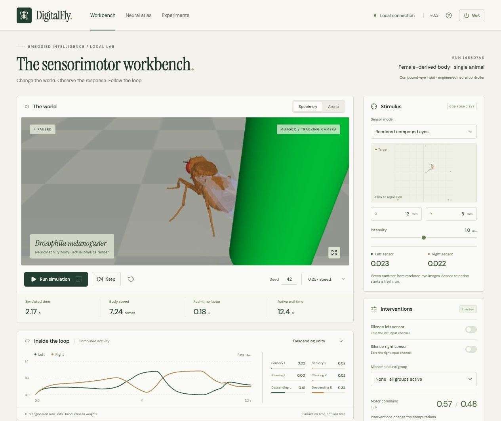

<h1 align="center">DigitalFly</h1>

<p align="center"><b>A virtual fruit fly you can poke.</b><br>
A physics-simulated fly walks toward what it sees, steered by a brain you can inspect, silence and tune:<br>six hand-built units, or circuits wired from the FlyWire connectome, with rate or spiking neurons.<br>
Build your own circuit around any cell type, run batch experiments, and compare with recorded flies.<br>
Everything runs on your own computer, in your browser.</p>

<p align="center"></p>

> **Why is the repo called frankenfly?** Because this fly is stitched together from parts: a female fly's physics body ([NeuroMechFly](https://neuromechfly.org/)), brain scans of two *different* flies (one female, one male), and a choice of brains. The default is six hand-built "rate units". The others are patches of the female fly's connectome ([FlyWire](https://flywire.ai/) v783): 3,000 neurons around the DNa02 steering neurons, a 4,000-neuron circuit around three descending neuron types (DNa01, DNa02 and DNp09), or any circuit you build, up to the whole brain. The body and physics are real. In the connectome brains, who connects to whom, and how strongly, is real data, but each connection's sign is assumed from its predicted transmitter, and the wiring to the eyes and legs is engineered. They are not an uploaded fly brain and not biologically validated. The DNa02 circuit circles the target instead of reaching it; the three-type circuit reaches it, because one of its readouts, DNp09, turns toward it.

## What you can do

- **Run the closed loop.** Move the green target and watch the fly turn and walk toward it. Neural activity, leg contacts and walking rhythm update live, and you can look through the fly's own compound eyes (721 facets per eye).
- **Swap the brain.** Drive the body with the engineered six-unit controller or a connectome circuit, with rate units or the spiking neurons of Shiu et al. 2024, and inspect it cell type by cell type while it runs, including the strongest pathways into its steering neurons.
- **Build your own circuit.** Pick any FlyWire cell types or neurons as seeds, choose hops, synapse threshold and size (or the whole brain), and run the result: in the app or from the command line.
- **Intervene.** Silence the left or right sensor, a group of units, either DNa02 neuron or any cell type in the circuit, and see how behavior changes.
- **Run experiments.** Start from a one-click first experiment, script timed stimulus changes, compare conditions (including the two brains) across matched random seeds, and keep every trial. Export runs as CSV, JSON and ZIP, and replay them exactly.
- **See through FlyVis eyes (optional).** Run the rendered eye images through FlyVis, a connectome-constrained model of the fly's optic lobe, and let its cell types drive the circuit's visual neurons through FlyWire wiring.
- **Compare with a real fly.** Import a published recording of both DNa02 neurons in a walking fly and fit how its turning follows them, side by side with the model.
- **Analyze at scale.** A research toolkit (Python and command line) runs batches of trials and parameter sweeps in parallel, measures a circuit's left/right bias, silences every cell type in turn to find what drives it, traces pathways, and fits turning against readout activity in runs or recorded flies.
- **Explore real anatomy.** Rotate male and female fly brains with twelve published neuron reconstructions, or import your own small wiring diagram to inspect.



**The default brain:** six engineered units, live, with every weight visible and editable. The connectome brain has its own live view, by cell type, in the same **Live circuit** tab.


**Real anatomy** from published connectomes. With the connectome brain running, the female DNa02 skeletons glow with its computed activity, labeled as model output.


## Quick start

You need **Python 3.12**, **Node.js 22.12 or newer** (up to 26) with npm, and OpenGL for the 3D views. DigitalFly is tested on Apple-silicon macOS and on x86-64 Linux with EGL rendering.

```sh
git clone https://github.com/Jeevash23/frankenfly.git
cd frankenfly
./scripts/setup.sh
./scripts/start.sh --open
```

Setup builds a local Python environment and installs pinned dependencies, which takes a few minutes the first time. The app opens paused at http://127.0.0.1:8000. Add `--vision` to start with compound-eye input. To stop it, click **Quit** in the app or press Ctrl+C in the terminal.

**No Python 3.12?** If [uv](https://docs.astral.sh/uv/) is installed, setup uses a uv-managed Python 3.12, installing one first if needed (about 30 MB). Otherwise install Python 3.12 from [python.org](https://www.python.org/downloads/) or with Homebrew (`brew install python@3.12`), then point setup at it:

```sh
PYTHON_BIN=/path/to/python3.12 ./scripts/setup.sh
```

## How it works

```text
target ─► sensors: target bearing, or rendered compound-eye pixels
       ─► neural model, either
            six leaky rate units: sensory ─► steering ─► descending, or
            a FlyWire circuit (rate or spiking): visual projection neurons ─► … ─► readout neurons left/right
       ─► left/right descending command
       ─► FlyGym walking controller: joint and adhesion targets
       ─► MuJoCo physics ─► new body pose ─► back to the sensors
```

All simulation runs in Python; the browser only displays it. Physics advances every 0.1 ms, the neurons every 1 ms, and the descending command every 10 ms. A run is deterministic for its seed, so saved experiments replay exactly on the same software stack.

## Documentation

- [Usage guide](docs/USAGE.md): controls, saved runs, replay and troubleshooting
- [Research guide](docs/RESEARCH.md): a first experiment, signal definitions, data sources and limits
- [Architecture](docs/ARCHITECTURE.md): the closed loop, equations, timing and safety boundaries
- [Dependencies](docs/DEPENDENCIES.md): pinned versions and how to reproduce validation
- [Status](STATUS.md): what's implemented and how it was validated

## Development

```sh
./scripts/dev.sh                   # hot-reloading UI at http://127.0.0.1:5173
./scripts/check.sh                 # every test (including real physics), format check and build
./scripts/check.sh --fast          # skips the FlyGym physics tests
npm --prefix frontend run format   # format the frontend with Prettier
```

GitHub Actions runs the fast checks and the frontend checks on Ubuntu for every pull request. To rebuild the connectome circuits or build your own from FlyWire data (about 61 MB of downloads plus a 50 MB build-only dependency, once), see the [research guide](docs/RESEARCH.md#building-your-own-circuits). The research toolkit is `scripts/toolkit.py` ([examples](docs/RESEARCH.md#the-research-toolkit)).

The backend is FastAPI with FlyGym and MuJoCo (`backend/`); the interface is React with Vite (`frontend/`). Restart `dev.sh` after Python changes. To regenerate the demo animation above, run `backend/.venv/bin/python scripts/make_demo_gif.py`.

## What it is not

DigitalFly does not simulate the nerve cord, flight, learning, courtship or a male body, and it has been compared with only one recorded fly, not fitted or validated. The six-unit controller has hand-chosen weights. The connectome model uses real wiring, but assumed signs and an engineered connection to the eyes and legs; the DNa02 circuit, and both committed circuits with spiking neurons, steer with a strong left-turn bias, and the whole brain can be built but runs far slower than real time. The compound-eye encoder is an engineered green-object detector. Results show what these models compute, not established fly biology. The [research guide](docs/RESEARCH.md#what-remains-before-biological-simulation-claims) describes what a biologically validated version would need.

## License and credits

Code and documentation are licensed under [Apache-2.0](LICENSE); see [NOTICE](NOTICE). The scientific data in `data/atlas/` and `data/circuits/` is **not** covered by that license and keeps its original licenses, including CC BY-NC 4.0 (non-commercial) for all FlyWire-derived data, the connectome circuit included. See [data/atlas/LICENSE.md](data/atlas/LICENSE.md) and [data/circuits/LICENSE.md](data/circuits/LICENSE.md).

Built on [FlyGym / NeuroMechFly](https://github.com/NeLy-EPFL/flygym) (Apache-2.0) and [MuJoCo](https://github.com/google-deepmind/mujoco). Anatomy comes from [FlyWire](https://flywire.ai/), [MaleCNS](https://male-cns.janelia.org/) and [navis-flybrains](https://github.com/navis-org/navis-flybrains). The connectome circuit comes from FlyWire v783 through the [Bates/Lee lab compilation](https://github.com/sjcabs/fly_connectome_data_tutorial) and the data of [Shiu et al. 2024](https://github.com/philshiu/Drosophila_brain_model). Details are in [docs/ATTRIBUTION.md](docs/ATTRIBUTION.md).
